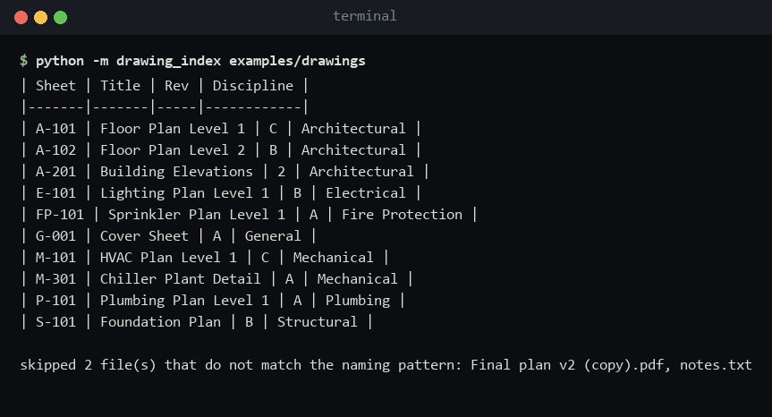

# drawing-index-generator

Builds a drawing index (sheet number, title, latest revision, discipline) from the file names in a drawings folder. Standard library only.



## What it is for

A drawing list kept by hand is out of date the day after the next revision arrives. If the files follow the pattern `A-101_Floor-Plan-Level-1_RevB.pdf`, the folder already holds everything a drawing index needs. Document controllers, project engineers and facility coordinators use this tool to produce the index in seconds, keep only the latest revision of each sheet, and see which files do not follow the naming pattern.

## Install

```
git clone https://github.com/yassine2med/drawing-index-generator
cd drawing-index-generator && pip install -r requirements.txt
```

## How to use

| I want to | Command |
|---|---|
| Index the latest revision of every sheet as a Markdown table | `PYTHONPATH=src python -m drawing_index examples/drawings` |
| List every revision, not only the latest | `PYTHONPATH=src python -m drawing_index examples/drawings --all-revisions` |
| Keep one discipline, as CSV for a spreadsheet | `PYTHONPATH=src python -m drawing_index examples/drawings --discipline M --format csv` |
| Write the index to a file | `PYTHONPATH=src python -m drawing_index examples/drawings --out index.md` |
| Show help | `PYTHONPATH=src python -m drawing_index --help` |

Exit codes: 0 on success, 2 when the folder does not exist or an option is wrong. Files that do not match the pattern are named on the error stream, so a CSV piped to a file stays clean.

Example:

```
PYTHONPATH=src python -m drawing_index examples/drawings
```

Output:

```
| Sheet | Title | Rev | Discipline |
|-------|-------|-----|------------|
| A-101 | Floor Plan Level 1 | C | Architectural |
| A-102 | Floor Plan Level 2 | B | Architectural |
| A-201 | Building Elevations | 2 | Architectural |
| E-101 | Lighting Plan Level 1 | B | Electrical |
| FP-101 | Sprinkler Plan Level 1 | A | Fire Protection |
| G-001 | Cover Sheet | A | General |
| M-101 | HVAC Plan Level 1 | C | Mechanical |
| M-301 | Chiller Plant Detail | A | Mechanical |
| P-101 | Plumbing Plan Level 1 | A | Plumbing |
| S-101 | Foundation Plan | B | Structural |

skipped 2 file(s) that do not match the naming pattern: Final plan v2 (copy).pdf, notes.txt
```

Run the tests with `python -m pytest -q`.

## How it works

1. Each file in the folder and its sub folders is matched against `SHEET_Title-With-Hyphens_RevX.ext`, where the sheet is one or two capital letters, a dash and three digits (`A-101`, `FP-101`).
2. Allowed extensions are pdf, dwg, dxf, rvt and png. Anything else, or any name that does not match, is skipped and reported.
3. The discipline comes from the letters before the dash: G, C, A, S, M, E, P, FP, T. Unknown letters show as Other.
4. Revisions sort as A, B, Z, AA, then plain numbers by value. Only the highest revision of each sheet is kept unless `--all-revisions` is set.
5. The index is sorted by sheet number and written as Markdown or CSV.

## Limits

- It reads names only. It does not open the files, so it cannot read a title block or a revision date.
- A plain number revision counts as newer than any letter revision. Mixed schemes on one sheet need a person to check.
- The naming pattern and discipline letters are in `src/drawing_index/core.py`. Edit them if your standard differs.
- Sub folders are scanned too, so the same sheet in two folders is treated as one sheet.

## License

MIT. Yassine Emhamed, 2026.
